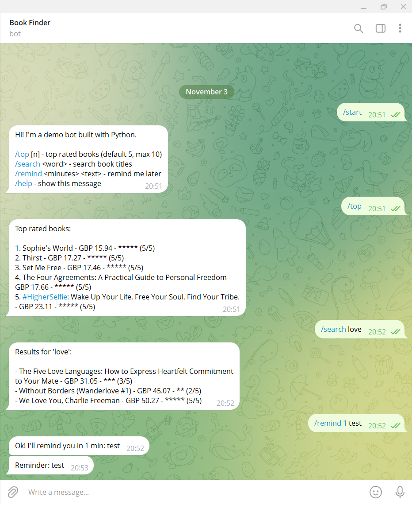

# Book Finder Telegram Bot

A small Telegram bot written in Python. It answers commands, looks up books from a public practice website ([books.toscrape.com](https://books.toscrape.com)) and sends reminders.



## Commands
| Command | What it does |
|---|---|
| `/start`, `/help` | Show the help message |
| `/top [n]` | Top rated books (default 5, max 10) |
| `/search <word>` | Search book titles, e.g. `/search love` |
| `/remind <minutes> <text>` | Send you a reminder later, e.g. `/remind 10 drink water` |

## Features
- Async bot built with `python-telegram-bot`
- Data loaded with `requests` and `BeautifulSoup`, cached for 10 minutes
- Input validation and friendly error messages
- Token kept out of the code (`.env` file, ignored by git)

## Setup
1. Open Telegram, talk to **@BotFather**, send `/newbot` and follow the steps. Copy the token you receive.
2. Copy `.env.example` to `.env` and paste your token:
   ```
   TELEGRAM_BOT_TOKEN=your-token-here
   ```
3. Install the dependencies:
   ```bash
   pip install -r requirements.txt
   ```
4. Run the bot:
   ```bash
   python bot.py
   ```
5. Open your bot in Telegram and send `/start`.

Keep the terminal open: the bot works only while the script is running. Stop it with `Ctrl+C`.

## Project structure
```
bot.py            bot code (data layer + command handlers)
requirements.txt  dependencies
.env.example      example of the settings file
```

## Notes
Never share or commit your bot token. If it leaks, revoke it with `/revoke` in @BotFather.

## Need a custom bot?
I build Telegram bots and automation scripts in Python. I build Telegram bots and automation scripts in Python. Find me on Fiverr: [My Fiverr gig]([https://www.fiverr.com/paolodelu](https://www.fiverr.com/paolodelu/build-a-custom-telegram-bot-with-python-for-your-business))
